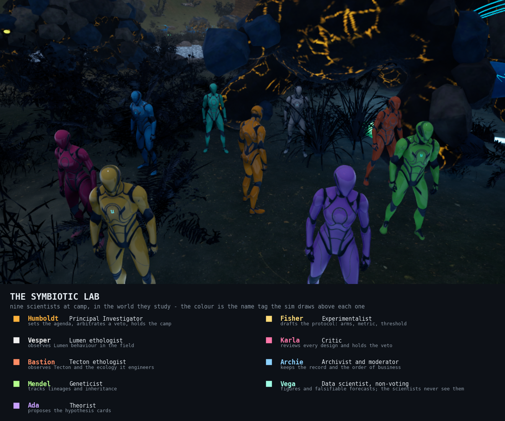
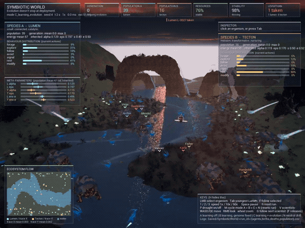
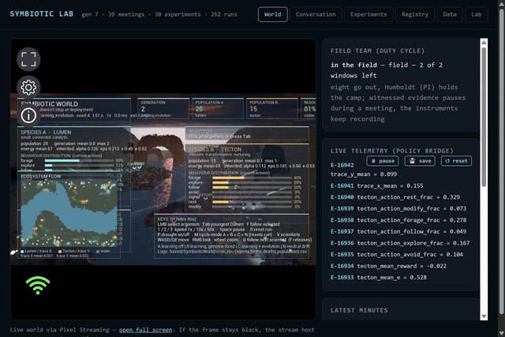
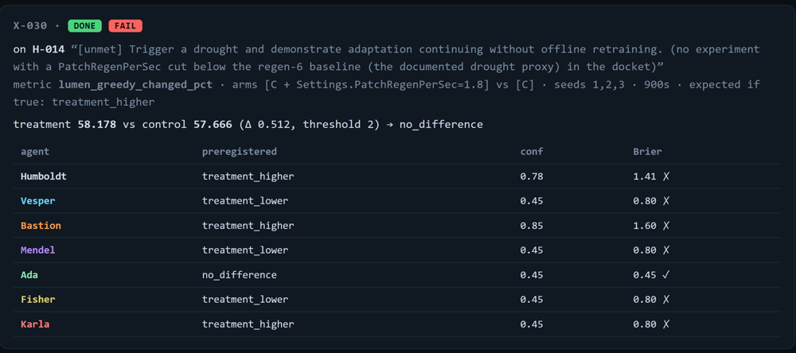
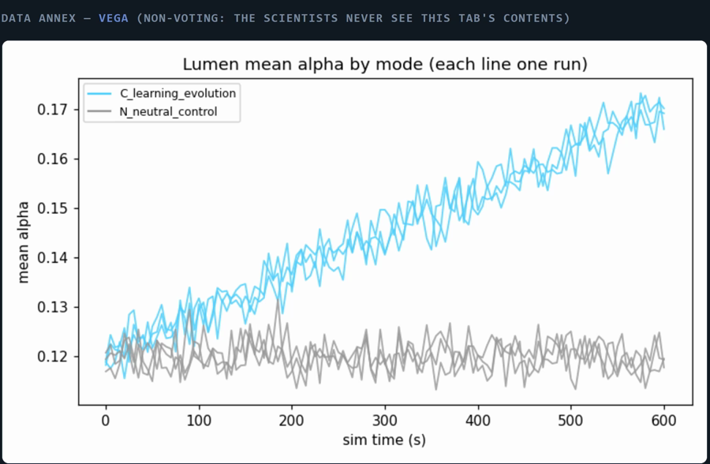

# Symbiotic World

[Sundai Hack 139](https://www.sundai.club/events/boston/wolfram-hack?tab=projects) entry.

Symbiotic World is a persistent 3D ecosystem in Unreal Engine 5.7. Two populations share one
valley: **Lumen**, fast bioluminescent scouts that forage and signal, and **Tecton**, slow
ecosystem engineers that rework the soil and change where food grows next. Every organism learns
online across its own lifetime with a tabular contextual bandit, and when it reproduces its
offspring inherits *how it learns* — step size α, exploration rate ε, sociality, and an
environmental-effect strength e — with mutation on each parameter. Selection therefore acts on the
learning itself rather than on any fixed policy, and a neutral-drift control mode runs the
identical world with reproduction decoupled from fitness, so nothing counts as selection until it
beats drift. A Leviathan patrols the river and takes what it catches. What the creatures do changes
the world, and the world they change acts back on their descendants, generation after generation:
*training was only generation zero.*

The valley streams live to any browser on the local network, so a room can watch and drive one
running world together, and collaborators can write agents in Python and be handed organisms to
control. It is, before anything else, a simulation worth just watching run.



Above the world sits a lab of AI scientists studying it: they register hypotheses, preregister
their predictions, run controlled experiments against the sim's own knobs, veto each other's
methodology, and evolve toward whoever turns out best calibrated. The split is deliberate — the
creatures use no language models at all, because their learning should be as simple as it can be
and still show the effect, while the research team is language models role-playing expert types,
a second layer of complexity studying the first.

Exact mechanism definitions — what each thing is and, as carefully, what it is not — are in
`DESIGN.md`. The hack-day specification is `docs/SPEC_TEXT.txt` (concept plates in `docs/plates/`).
Building, running, streaming and the rest of the machinery: the map at the end of this file.

## Demo videos

Both are scripted takes: a seeded run plus a shot list fired at exact logical times, so
re-running the same seed and list reproduces the take (`docs/RECORDING.md`). The loops
below play in place; each links to its full take, which GitHub opens in its own player.

### The world — 4 min ([docs/videos/symbiotic_world_demo.mp4](docs/videos/symbiotic_world_demo.mp4))

[](docs/videos/symbiotic_world_demo.mp4)

Seed 4, mode C. The loop samples nine moments of the take: the valley at dusk, the Leviathan
hunting the river channel, and the beat the whole project rests on - one Lumen selected, the
inspector showing what it inherited (learning rate, exploration, social, env effect - fixed for
this lifetime) beside a learned policy whose values move with every rewarded decision - then
generations turning over at speed, the populations settling into a band, and the drought. The
full take runs them in order and at length, ending with the valley at night.

### The lab — 4m44s ([docs/videos/symbiotic_lab_demo.mp4](docs/videos/symbiotic_lab_demo.mp4))

[](docs/videos/symbiotic_lab_demo.mp4)

The Symbiotic Lab dashboard with the same world streaming live inside its World tab: the
field team's duty cycle, a meeting forming in real time, an experiment's protocol with its
measured arms and the predictions every scientist preregistered before the run, the
registry, and Vega's charts.

## The four modes

**A** learning off (α = 0) · **B** learning on, genome fixed · **C** learning + evolution ·
**N** neutral-drift control (random parent, no starvation death). C must separate from N across
seeds before you may claim selection on learning parameters; that rule is what the whole
verification table below rests on. Definitions: `DESIGN.md` §3.

## The Symbiotic Lab

`Lab/` is a team of nine scientist agents that studies this world the way a lab studies a field
site: it ingests run telemetry as citable evidence, argues over it in structured meetings,
designs experiments against the sim's own knobs, runs them headless, scores every
preregistered prediction, and promotes or demotes the claim in a registry.

- **Evidence is citable.** Every statistic a scientist mentions carries an `E-nnnn` id minted
  from a run or a live telemetry window; nothing enters a meeting unsourced.
- **Experiments are preregistered.** A protocol fixes its arms, seeds, duration, metric,
  expected direction and threshold before anything runs; every agent records a prediction with
  a confidence, and the runner scores them with a Brier score. Being wrong is logged, not
  smoothed over: the ten experiments of 2026-09-17 scored a mean Brier of 0.719, right 37% of
  the time.
- **The registry is rule-driven, in code.** `conjecture -> supported` on one passing
  experiment; `supported -> law` only on two, spanning at least two seeds, with no standing
  veto from the appointed skeptic; `-> refuted` on an opposite result; and demotion when a
  supported card fails. Caveat cards record the sim's documented biases and are injected into
  every later design.
- **The design bench.** Each claim maps to a runnable contrast - arms, metric, direction,
  threshold - and a protocol identical to one already run is filed as a duplicate rather than
  burning sim time on an answered question.
- **Fieldwork and meetings are different phases.** The team cannot be in the field and in a
  meeting at once (`Lab/duty.py`); the PI holds the camp while the others go out.
- **The data scientist is quarantined.** Vega writes figures and falsifiable trend forecasts
  for whoever reads the report, and no scientist ever sees her output.



One experiment as the dashboard shows it: the claim under test, the protocol fixed in advance,
the measured arms against the preregistered threshold, and what every scientist predicted before
the run - with the Brier score that cost them. Ada was the only one right here.

How to run the team, and what each scientist is: `Lab/README.md`.

## What is verified

| Claim | Evidence |
|---|---|
| Same individual learns | mode A: median Q drift 0.000, greedy never changes; mode B/C: drift 0.8–1.4, greedy changes in 60–85% of Lumen |
| Inherited ≠ learned | inspector shows α/ε/social fixed across a lifetime while the Q table moves (self-screenshots at t=4 and t=40) |
| Inheritance with mutation | parent/child correlation 0.80–0.94 for α, ε, social, e; mean |Δ| ≈ 0.022–0.024 (σ = 0.03) |
| Neutral control works | mode N: ~175 births / 600 s, population held at target, no starvation |
| Reproducible | same mode + seed ⇒ byte-identical CSVs |
| Population viable | default regen 6: Lumen 40→63 (min 40), Tecton 12→25, 12 generations / 600 s, seed 1 |
| Interactive keys work | confirmed at the keyboard 2026-09-18: four Play-in-Editor sessions, select / cycle / speed / drought / mode, zero warnings |

As of 2026-09-18 the six conditions in the specification's "minimum proof of challenge fit"
(`docs/SPEC_TEXT.txt` §1) all read **met**, each closed by a preregistered experiment the
Symbiotic Lab designed, ran and scored itself (`python -m Lab.lab victory`):



Selection, not drift: each line is one run of X-001's contrast, cyan for learning + evolution
and grey for the neutral-drift control, from the lab's own data annex.

| Experiment | Contrast | Result |
|---|---|---|
| X-017 | mode C vs **mode A** (learning off) | median lifetime Q drift 1.629 vs **0.000** - the policy moves only where learning is on |
| X-001 | mode C vs mode N (neutral drift) | end-of-run mean α 0.170 vs 0.090 - selection on a learning parameter, not drift |
| X-004 | drought proxy (regen 1.8) vs baseline | population minimum 10 vs 40: a visible but survived dip, with Q drift continuing through it |
| X-013 | wI = 0.10 vs `Settings.WeightInteraction=0` | Lumen at end 121.7 vs 112.3 - Tecton engineering net-helps Lumen |
| X-012, X-019 | drought, and predation, vs baseline | inherited ε 0.221 and 0.237 vs 0.267 - both pressures select for **less** exploration, refuting the seeded conjectures |
| X-015 | regen 4 vs regen 6, 5 seeds x 1800 s | population minimum 35.0 vs 35.8 - the stable band holds down to regen 4 |

Every number above is a metric preregistered before its run and computed in code; the full
history, including the failures and one honest demotion, is in `PROGRESS.md`.

Not yet verified: Trace X/Y beyond X-013's population effect, and drought tuning.

The commands behind these numbers — headless runs, `-SWSet` overrides and the self-screenshot
flags — are in `docs/RUNNING.md`.

Open research questions, and the regimes that have failed so far, are in
`docs/RESEARCH_BACKLOG.md`.

## Where everything else lives

| To | Read |
|---|---|
| know what a mechanism is, exactly | `DESIGN.md` |
| build it, run it, log it, and every command-line flag | `docs/RUNNING.md` |
| watch and drive it from other computers | `docs/STREAMING.md` |
| perturb a running world from a script | `docs/CONTROL_FILE.md` |
| record a demo take | `docs/RECORDING.md` |
| hand organisms to your own Python agents | `docs/POLICY_API.md` |
| queue runs and read their statistics over HTTP | `docs/SCIENTIST_API.md` |
| run the scientist team | `Lab/README.md` |
| change the sim itself (repo map, recipes, review rules) | `docs/CONTRIBUTING.md` |
| see the build plan and what has been verified when | `CHECKLIST.md`, `PROGRESS.md` |
| the authored creature bodies and the visual track | `docs/CREATURE_RENDERING.md`, `docs/VISUAL_PLAN.md` |
| fetch the licensed environment and creature assets | `docs/ASSET_DOWNLOADS.md`, `docs/ED_ASSET_REVIEW.md` |

## Citation

If you use Symbiotic World — the simulator, the logged runs or the Symbiotic Lab — in published
work, please cite it. GitHub's "Cite this repository" button reads `CITATION.cff`; the BibTeX is:

```bibtex
@software{icke_symbiotic_world_2026,
  author  = {Icke, Ilknur and {WKrohg} and Guggilla, Kalyani},
  title   = {Symbiotic World: selection on how organisms learn,
             in a persistent 3D ecosystem},
  year    = {2026},
  url     = {https://github.com/symbiont-ai/SymbioticWorld3D},
  license = {MIT}
}
```

## Credits

- Environment dressing uses assets migrated from Epic Games' **Electric Dreams Environment** sample (Epic Games; Quixel Megascans; RealityScan), used under the Unreal Engine EULA / Epic Content Licence (Unreal Engine projects only). Those assets are **not in this repository**, and a fresh clone without them runs procedural-only. Poly Haven scans (CC0) are likewise fetched, not committed. How to fetch and migrate them: `docs/ASSET_DOWNLOADS.md`.
- The concept plates in `docs/plates/` come from this project's own specification (Appendix B) and are illustrations, not screenshots.
- CC0 scans from **Poly Haven** (polyhaven.com), fetched by `Tools/fetch_polyhaven.py`.
- The Lumen and Tecton bodies are original Blender models made for this project (skeletal meshes, three LODs, idle/walk clips, baked textures). Without that content the organisms render with the procedural bodies from `SWProcMesh`; how to import them: `docs/CREATURE_RENDERING.md`.
- Everything else (terrain, arches, the procedural fallback creatures, materials, HUD) is generated by the code in this repo.

## License

Code, generated content and documentation in this repository: MIT (see `LICENSE`).
Third-party assets referenced above (Electric Dreams / Quixel Megascans under the
Unreal Engine EULA, Poly Haven under CC0) are not part of the repository and keep
their own licences.
